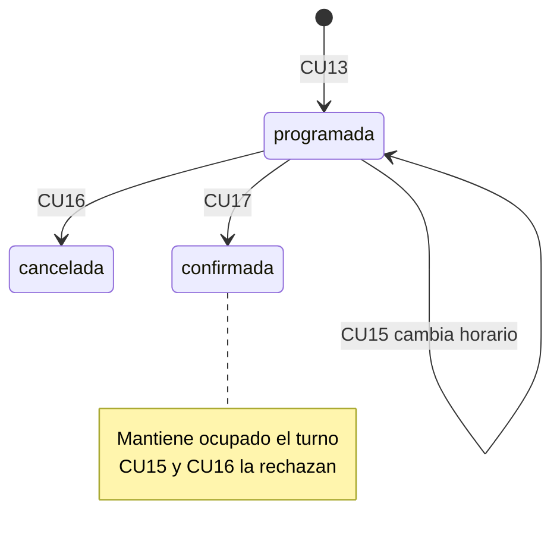

# CU17 — Confirmar citas médicas

Administrador y recepcionista pueden confirmar una cita existente programada,
conservando código, paciente, médico, especialidad, horario, duración y demás datos.
Se cambia únicamente estado a `confirmada`; se registra responsable y momento.
No se crean ni eliminan citas. Médico y paciente no acceden a la operación.
No se implementa CU18 ni un estado de inasistencia.

## Migración 007 propuesta y autorización

La inspección de `clinica_vida_salud_dev` local confirmó PostgreSQL 17, 001–006,
nueve tablas y doce claves foráneas. El CHECK actual admite programada/cancelada/
atendida, y GiST solo considera programada. Es indispensable cambiar ambos juntos.

`database/migrations/007_citas_confirmacion.sql` realiza exclusivamente:

- Bloqueo de citas e historial dentro de una sola transacción, sin ventana visible
  sin exclusión ni modificación de los registros existentes.
- Ampliación del CHECK de citas para incorporar confirmada.
- Reconstrucción de la exclusión GiST con el mismo médico, intervalo UTC [inicio,fin)
  y nombre, incluyendo programada y confirmada. No se alteran otros índices.
- Ampliación de los CHECK de historial: confirmacion conserva inicio_anterior =
  inicio_nuevo y registra programada → confirmada. Se mantienen reprogramación y
  cancelación. El CHECK de motivo de 006 obliga a NULL en confirmaciones.
- Reemplazo de la función del trigger existente: programada conserva las reglas de
  fecha futura, paciente/médico activos y bloqueos. Las nuevas reservas directas
  confirmadas también las comprueban. La transición que cambia exclusivamente
  estado de programada a confirmada conserva la reserva previa y bloquea el médico;
  no agrega una política de anticipación ni obliga a reactivar catálogos.

No crea tablas, columnas ni FK: se mantienen nueve tablas y doce referencias.
No cambia migraciones 001–006, seed, cuentas o `.env`. Aplicación manual local
mediante `php scripts/aplicar-migracion-007.php --autorizado`, tras autorización
expresa y verificación del destino/esquema 006. Cualquier error revierte todo.
No repetir en una base con 007. No se ejecuta desde Docker ni se accede a Render.

007 fue autorizada expresamente y aplicada una sola vez en `clinica_vida_salud_dev`.
El asistente comprobó 006 antes del DDL y 007 antes de confirmar la transacción.
La comparación posterior de conteos y huellas de las nueve tablas confirmó que
no se modificó ni perdió ningún registro. No repetir la migración.

## Integración y flujo

GET `/citas/{id}/confirmar` muestra código, paciente, médico, especialidad, fecha,
hora y estado, sin escritura. POST exige sesión, rol, CSRF, acción confirmar y
referencia vigente de inicio/revisión del historial. El servidor deriva identidad,
estado y actor; no los confía a campos manipulables. PRG lleva al detalle CU14.

CU12 y CU13 consideran ocupadas programada y confirmada. CU14 muestra y filtra
confirmada. CU11 protege también las confirmadas futuras al editar/desactivar
horarios. CU15 y CU16 mantienen su regla de solo programada, sin nuevas transiciones.

Bloqueos compatibles: médico FOR SHARE → cita FOR UPDATE → usuario FOR SHARE.
Relectura de estado y referencia tras esperar; UPDATE e historial en una misma
transacción o savepoint compatible. Una segunda confirmación o un formulario
anterior a CU15/CU16 se rechaza. GiST impide otra reserva sobre una confirmada,
incluso con sesiones concurrentes. No se agrega una segunda cita para confirmar.

## Pruebas y UML

Pruebas de integración, HTTP, concurrencia, navegador de escritorio/celular, esquema
y regresión CU01–CU16 usan datos ficticios y limpieza por IDs propios.
Inventario y resultados ejecutados: [PRUEBAS_CU17.md](PRUEBAS_CU17.md).
El [mapa de código](MAPA_DEL_CODIGO.md) documenta controlador, servicio, repositorio,
pantallas y secuencia transaccional. La máquina de estados agrega solo
programada → confirmada; confirmada conserva ocupación y no admite CU15/CU16.

## Reglas y alternativas

- RN-CON01–05: existencia y sesión; solo administrador/recepcionista activos y cita
  programada. Inexistente: 404; rol no autorizado: 403; sin sesión: redirección a
  login. Confirmada/cancelada/atendida se rechazan con 409 sin eventos adicionales.
  No existe estado de inasistencia; cualquier estado diferente de programada se rechaza.
- RN-CON06–10: UPDATE únicamente del estado. Código e identidad siguen siendo los
  mismos; evento confirmacion con usuario FK, `clock_timestamp()` TIMESTAMPTZ,
  inicios anterior/nuevo iguales y motivo_cancelacion NULL.
- RN-CON11–14: READ COMMITTED de escritura o savepoint compatible; bloqueo médico
  antes de cita y relectura del token después de esperar. Un fallo SQL revierte
  estado y evento; el diagnóstico público no expone SQL, credenciales o datos clínicos.
  Si gana CU15, se debe revisar el horario nuevo antes de confirmar; si gana CU16,
  CU17 rechaza cancelada; si gana CU17, CU15 y CU16 rechazan confirmada.
- RN-CON08/15: GiST usa programada/confirmada. CU12 consulta esos dos estados y CU13
  usa esa misma disponibilidad dentro de su transacción; no existe una ventana
  de liberación al confirmar. CU11 protege ambos estados futuros bajo su bloqueo.
- RN-CON16: roles en servidor, CSRF, escape HTML y parámetros SQL. GET no escribe.
  Acción ausente o malformada: 422; referencia vieja o malformada: 409; CSRF: 419;
  método distinto de GET/POST: 405. Éxito: 303 al detalle, aviso de una sola lectura.

`atendida` permanece en el esquema, pero CU17 no implementa la transición hacia
ese estado ni nuevas acciones de asistencia. No se agregan multas, anticipación
obligatoria, reasignaciones, envíos de mensajes ni autogestión del paciente.
