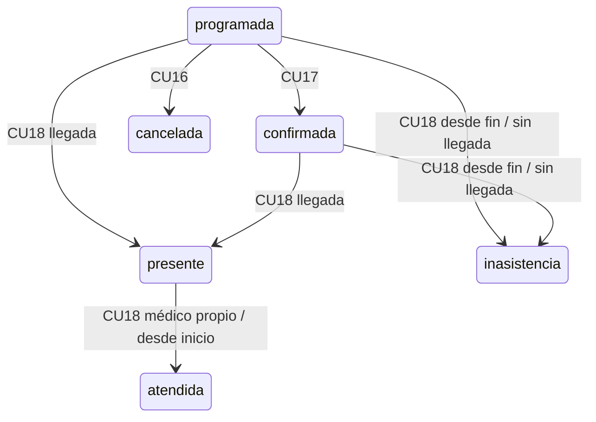

# CU18 — Llegada, atención completada e inasistencia

## Diseño y permisos

Se agrega el estado intermedio `presente` y el terminal `inasistencia`. Llegar no
significa terminar la atención. Flujo: programada/confirmada → presente → atendida;
alternativa: programada/confirmada → inasistencia, solo al terminar el intervalo.
Cancelada, atendida e inasistencia no admiten acciones CU18 ni transiciones inversas.
CU15–CU17 conservan su política de solo programada. No se desarrolla CU19.

Administrador y recepcionista registran llegada o inasistencia. Solo el médico
activo vinculado a la cita puede finalizar atención, desde presente y no antes
del inicio previsto. No se agrega una excepción administrativa para finalizar:
la relación médicos.usuario_id ya permite respetar la separación de funciones.
El administrador consulta trazabilidad; recepción y médico ven el estado y las
marcas administrativas necesarias, con el médico limitado a su propia agenda.
Paciente conserva los permisos existentes, sin acciones administrativas nuevas.

No se inventa una ventana de anticipación, tolerancia, multa o motivo clínico.
Llegada exige estado programada/confirmada y confirmación explícita, sin un corte
horario adicional no especificado. Inasistencia exige ausencia de llegada válida
y ahora >= inicio + duración; atención exige presente y ahora >= inicio.
Los instantes se comparan como fechas con zona America/La_Paz. Nunca se automatiza
inasistencia por el paso del tiempo. No se solicitan diagnósticos o texto clínico.

## Migración 008 aplicada solo localmente

`database/migrations/008_citas_asistencia.sql` adapta únicamente:

- CHECK de estados: incorpora presente e inasistencia.
- GiST del mismo médico/intervalo UTC [inicio,fin): ocupan programada, confirmada,
  presente, atendida e inasistencia. Cancelada es el único estado que no ocupa.
  La llegada y la atención no liberan el intervalo; los terminales conservan
  integridad histórica. No se habilita reservar períodos pasados desde CU13.
- CHECK de tipos/transiciones de historial: llegada, atencion e inasistencia,
  conservando los tres eventos de CU15–CU17. Los inicios siguen iguales para CU18;
  usuario FK y cambiado_en TIMESTAMPTZ distinguen responsable y momento de cada acción.
- CHECK temporal de historial: atención desde el inicio e inasistencia desde el
  final de los 30 minutos ya exigidos por citas_duracion_ciclo1.
- Índice único parcial cita/tipo para los eventos CU18: protege contra duplicados.
  Los índices y claves anteriores permanecen. Motivo_cancelacion sigue siendo
  exclusivo de cancelación y NULL en los eventos CU18.

No hay tablas o columnas nuevas: siguen nueve tablas y doce FK. No se reescriben
citas ni historial, ni se alteran migraciones 001–007. La función/trigger de 007
se revisó y se conserva: los estados CU18 no son una nueva reserva, y el servicio
valida roles, transiciones y tiempos bajo bloqueo. Los terminales históricos sin
eventos de llegada se conservan sin inventar fechas o responsables.

El ejecutor `scripts/aplicar-migracion-008.php --autorizado` comprobó identidad
local, PostgreSQL 17, contrato 007 y ausencia de superposiciones incompatibles con
la nueva exclusión antes de escribir. Todo el DDL y su verificación se ejecutaron
en una sola transacción, con rollback ante error. No se aplica sin autorización,
no se inicializa desde Docker, y Render queda fuera del procedimiento.

008 fue autorizada expresamente y aplicada una sola vez en
`clinica_vida_salud_dev`, PostgreSQL 17.10 local. La inspección previa encontró
cero superposiciones y cero eventos incompatibles con el índice único.
La verificación posterior confirmó nueve tablas y doce FK. No volver a aplicarla.
`php scripts/inspeccionar-cu18-local.php` comprueba el contrato y ambos conteos
de conflictos en READ ONLY; `php scripts/verificar-cu15-local.php` detecta 001–008.

## Flujo implementado y concurrencia

GET/POST `/citas/{id}/llegada`, `/citas/{id}/atencion` y `/citas/{id}/inasistencia`.
GET muestra código, paciente, médico, especialidad, horario, estado y revisión;
POST exige sesión, rol, CSRF, confirmación y referencia vigente. Tras guardar,
PRG conduce al detalle CU14. El servidor deriva acción, actor y transición;
no acepta fecha, estado o responsable desde campos del cliente.

READ COMMITTED y orden médico FOR SHARE → cita FOR UPDATE → usuario FOR SHARE.
Se releen estado y revisión tras esperar. La vinculación del médico se comprueba
bajo bloqueo de la misma fila; otro médico no accede por URL ni por POST. Estado
e historial se confirman o revierten juntos. Una solicitud anterior a un cambio
de estado/horario debe revisarse de nuevo, aunque ambas acciones fueran válidas
por separado. No se generan eventos en rechazos, recargas o reenvíos.

CU11 protege cobertura de reservas vigentes incluyendo presente y atendida mientras
su intervalo no haya terminado. CU12 considera los cinco estados con ocupación;
CU13 usa esa misma consulta y GiST. CU14 integra acciones y marcas administrativas;
la trazabilidad completa queda restringida al administrador.

## Pruebas y UML

Se ejecutaron pruebas de integración, HTTP, concurrencia, navegador, esquema y
regresión CU01–CU17 con datos ficticios y limpieza de IDs propios. El servicio
usa el reloj real de PostgreSQL por defecto; puede inyectarse un reloj explícito
solo desde código de pruebas para límites temporales y carreras sin esperar 30
minutos ni modificar el reloj del sistema. No hay parámetros HTTP o variables de
entorno que permitan cambiar el reloj. Las marcas de esos fixtures son simuladas
y se distinguen de las pruebas realizadas con reloj real.

Inventario y resultados ejecutados: `PRUEBAS_CU18.md`. La máquina de estados agrega
presente e inasistencia, sin entidades nuevas: la traza usa citas_historial.

Precondiciones: sesión y usuario activos, cita accesible, rol/vínculo autorizado,
estado y horario compatibles, formulario vigente y confirmación con CSRF válido.
Flujo alternativo: cualquier conflicto, revisión anterior o fallo de persistencia
revierte estado e historial, muestra un error seguro y exige consultar nuevamente.
No existen correcciones inversas ni acciones masivas. Los terminales conservan
su historial. Detalles de alcance y resultados en el informe de pruebas.
