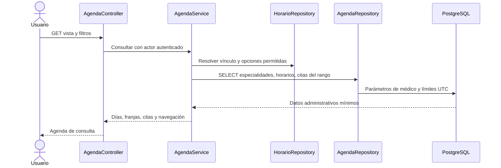

# CU19 — Agenda médica diaria y semanal

Implementación local en `feat/ciclo2-cu19-agenda-medica`, basada en CU18
`171c61936765367c1320c3ef6d1a5bab4eb8172f`. No requiere migración: reutiliza
001–008, nueve tablas y doce FK. No modifica GiST, CHECK, índices o triggers.
No se accede a Render ni se implementa CU20. Sin commit o push en esta entrega.

## Actores, precondiciones y permisos

Sesión y usuario activos, rol autorizado y filtros válidos. Administrador y
recepcionista seleccionan un médico; sin selección no se cargan agendas generales.
Se incluyen profesionales inactivos para consultar historia, igual que CU14;
se indica su estado y no se presentan franjas de atención operativa para ellos.
Médico únicamente consulta el profesional derivado de `medicos.usuario_id`.
Un identificador ajeno produce 403 antes de consultar la agenda; no se confía en
el selector ni en el parámetro enviado por el navegador. Sin vínculo se muestra
un mensaje controlado, sin opciones ni datos de otras agendas. Paciente: 403;
sin sesión: redirección a login. No se crean permisos o roles nuevos.

Los nombres de pacientes y especialidades son los permitidos en CU14 para estos
tres roles. No se seleccionan documentos, contactos, motivos, diagnósticos,
antecedentes, responsables del historial ni contraseñas. Cada enlace `/citas/{id}`
vuelve a pasar por la autorización existente de CU14; no se introduce una ruta
alternativa para consultar detalles sin control.

## Rutas, filtros y navegación

Solo GET: `/agenda` (alias diaria), `/agenda/diaria`, `/agenda/semanal`.
POST/PUT/DELETE de usuarios autorizados devuelven 405, sin acciones de escritura.
Los filtros son `fecha=AAAA-MM-DD`, `medico_id` y `estado`:

- `fecha`: hoy en America/La_Paz por defecto. Se validan formato, fecha real,
  UTF-8, tamaño y ausencia de controles; arreglos y valores malformados: 422.
- `medico_id`: entero positivo; médico inexistente para administración: 404.
  El médico puede omitirlo; el servidor lo determina por su cuenta vinculada.
- `estado`: `operativa` por defecto (sin canceladas), `todas` o uno de los seis
  estados reales: programada, confirmada, presente, atendida, inasistencia, cancelada.

Los enlaces mantienen profesional y filtro de estado. Se puede cambiar vista,
retroceder/avanzar un día o siete días y volver a hoy/semana actual. Una fecha
seleccionada en semanal determina el lunes de su semana hasta el lunes siguiente
exclusivo. La interfaz muestra lunes a domingo. No se inventa un rango comercial
de fechas; los años de entrada son 0001–9999, sin año cero y con enlaces desactivados
cuando la fecha de destino queda fuera de ese formato.

## Flujo principal y alternativas

1. Entrar desde navegación/panel, elegir profesional cuando corresponda, fecha y estado.
2. Validar permisos y filtros en servidor; resolver el profesional permitido.
3. Consultar especialidades, horarios activos y citas del rango mediante PDO parametrizado.
4. Agrupar por día local, ordenar por inicio e ID y presentar la agenda.
5. Navegar o abrir el detalle CU14 autorizado. Volver a consultar refleja cambios
   confirmados por CU13–CU18; CU19 no confirma, cancela ni mueve citas.

Alternativas: médico sin vínculo, sin selección, día/semana sin citas o sin horarios
son respuestas controladas. Un profesional inactivo conserva sus citas históricas.
Fechas/filtros inválidos: 422 sin eco peligroso; profesional inexistente: 404;
agenda ajena: 403. Las citas que ya no encajan en la configuración actual de CU11
no desaparecen: llevan una indicación explícita de fuera de atención actual.

## Presentación y límites temporales

La vista diaria presenta nombre/especialidades, fecha, franjas actuales CU11,
citas con paciente, especialidad, código, inicio/fin y etiqueta textual de estado.
Entre franjas se muestran períodos «Fuera de atención». Cada tramo activo se
divide en intervalos de treinta minutos, conforme al esquema existente.
Un intervalo sin ocupación es «Sin cita registrada», sin llamarlo disponible ni
ofrecer reserva. Un intervalo ocupado por una cita omitida por el filtro se
marca «Intervalo con cita fuera del día o filtro»; nunca se presenta como vacío.

La vista semanal usa siete columnas en escritorio, dos en tablet y días agrupados
en una columna en celular, sin tabla horizontal ni dependencias externas. Ambos
modos usan HTML semántico, etiquetas de formulario, navegación accesible y estados
con texto además de color. Canceladas tienen indicación histórica y estilo propio;
no se tratan como reservas activas. Las citas visibles quedan en orden cronológico.
Las citas canceladas pueden coexistir con el reemplazo que ocupa su turno.

Cada cita se presenta en el día local de su **inicio**, con rango `[desde,hasta)`.
Una cita a las 00:00 pertenece al nuevo día; el lunes siguiente no entra en la
semana anterior. Inicio/fin y navegación usan America/La_Paz. Los límites se
convierten a UTC antes de enviarlos a PostgreSQL, conservando también offsets
históricos con segundos. Una cita que termina al día siguiente indica `(+1 día)`.
Se consulta un margen de treinta minutos anterior al rango solo para detectar
arrastres: no expone otra fecha/paciente, pero evita mostrar como vacío el primer
intervalo si una cita del día anterior todavía lo ocupa.

## Consultas y relación con los otros casos

`AgendaRepository` contiene únicamente tres SELECT preparados: especialidades del
médico, horarios activos de la semana y citas de un profesional en un rango máximo
de siete días más el margen de arrastre. `HorarioRepository` existente resuelve
vínculo y opciones permitidas. Con selección administrativa hay cuatro consultas
agrupadas, tanto para un día como para una semana; el médico agrega la resolución
de su vínculo. Sin selección o sin vínculo no se consultan citas.

No hay consultas por celda o turno, SELECT * de pacientes ni carga de todo el
historial de citas. Los predicados actúan sobre medico_id/fecha_hora_inicio,
sin DATE() sobre la columna indexada, y reutilizan el índice existente de médico
y fecha. Las citas se leen con sus seis estados dentro del rango y luego se filtran
en memoria: así la ocupación que oculta un filtro no se convierte en un falso hueco.

CU11 aporta la configuración actual; CU12 conserva su cálculo de disponibilidad;
CU13 las reservas; CU14 los detalles y sus permisos; CU15 cambia el inicio;
CU16 conserva canceladas como historia; CU17/CU18 aportan sus estados ya existentes.
No se modifica ninguno de sus servicios ni las reglas de reserva/concurrencia.
Las lecturas no reservan, no toman bloqueos de fila y no cambian las transacciones
de los casos anteriores. Una recarga muestra datos confirmados; no es una reserva
ni una promesa de que no haya cambios concurrentes posteriores.

## Reglas RN-AG01–16 y UML

01–04: sesión/roles/vínculo en servidor. 05: orden inicio/ID. 06: franjas reales
y citas fuera de configuración identificadas. 07–09: límites y agrupación local.
10: cancelada histórica, oculta por defecto. 11/13: proyección mínima y detalle
protegido. 12: solo GET/SELECT. 14: errores controlados. 15: agenda vacía válida.
16: no se cambian reglas CU11–CU18 ni el esquema.

No hay entidad persistente nueva: AgendaService es una proyección de Cita,
Medico, Especialidad y HorarioAtencion. `citas_historial` permanece intacto.
Pruebas, límites, resultados e inventario: [PRUEBAS_CU19.md](PRUEBAS_CU19.md).
