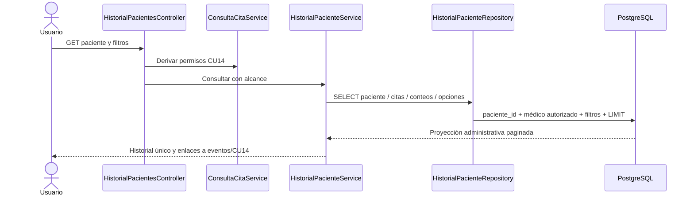

# CU20 — Historial de citas por paciente

Rama local `feat/ciclo2-cu20-historial-paciente`, basada en CU19
`09de4d9bf1a7aea0cd4b1ef5561201b949e7f921`. Reutiliza las nueve tablas y doce
FK del esquema 001–008. No requiere migración ni índices nuevos. No modifica
GiST, CHECK, triggers, servicios CU11–CU19 o registros preexistentes.
Sin commit, push, despliegue o acceso a Render. No se desarrolla CU21.

## Objetivo y actores

Consultar citas anteriores y futuras de un paciente con su horario vigente y
los eventos administrativos que realmente existen. No es historia clínica:
no hay diagnósticos, recetas, alergias, resultados, tratamientos o antecedentes.
No se seleccionan motivos clínicos o de cancelación, CI en los resultados,
contactos, dirección, fechas de nacimiento, hashes o información de autenticación.

Precondiciones: usuario activo autenticado, rol autorizado y paciente accesible.
Los permisos se derivan del actor de sesión mediante ConsultaCitaService de CU14:

- Administrador: pacientes y todas sus citas administrativas; ve el responsable
  de los eventos por su correo, igual que la trazabilidad administrativa CU18.
- Recepcionista: pacientes y citas administrativas; ve tipos/estados/horarios y
  momentos de los eventos, sin identidad del responsable.
- Médico: únicamente pacientes con al menos una cita asignada a su registro
  `medicos.usuario_id`, y únicamente las citas/eventos de ese mismo médico.
  Nunca obtiene otros médicos/especialidades del paciente en los selectores.
  No se le habilita el listado, detalle personal o CRUD general de CU04–CU06.
  La búsqueda de CU20 permite solo nombres/apellidos, sin buscar por CI.
- Paciente: permanece sin acceso al módulo (403), incluso con ficha vinculada.

Un médico sin registro vinculado recibe una búsqueda vacía con mensaje; acceder
directamente por ID produce 404. Un paciente inexistente y uno fuera del alcance
del médico tienen el mismo 404. Un filtro de otro médico se rechaza en servidor
con 422 por las validaciones existentes CU14. Cambiar el paciente, cita o filtro
de especialidad nunca amplía el alcance de la consulta SQL.

### Límite actual del rol Paciente y propuesta futura

La FK única `pacientes.usuario_id` existe, pero CU14 todavía rechaza al rol
Paciente; no hay lectura de sus propias citas ni ruta de detalle personal.
El campo por sí solo no constituye un portal ya implementado. Por eso CU20 no
improvisa identidad por CI, correo, nombre o parámetros, ni crea una cuenta o vínculo.
Se verifica el rechazo de la ficha propia vinculada y la ajena.

Integración futura propuesta, no implementada: un endpoint propio, por ejemplo
`GET /mi-historial-citas`, debe resolver la ficha exclusivamente desde el ID de
usuario autenticado y la FK validada administrativamente, sin aceptar paciente_id.
Necesitará su propia política de lectura y detalle mínimo, sin reenviar al CU14
actual que deniega a ese rol. Deben probarse vínculos ausentes/ajenos y cambios
de rol/actividad. No incorpora reservas, reprogramación o cancelación de CU25.

## Rutas, flujos y errores

Solo GET, compatibles con el enrutador existente:

- `/historial-citas`: buscar un paciente accesible.
- `/pacientes/{id}/historial-citas`: historial principal paginado.
- `/pacientes/{id}/historial-citas/{cita}/eventos`: eventos paginados de esa cita.

Las rutas se resuelven antes del patrón de pacientes existente. Identificadores
positivos válidos; inexistentes/fuera de alcance: 404. Sin sesión: login; rol no
autorizado: 403; filtros malformados: 422; POST/PUT/DELETE para roles permitidos:
405. No hay acciones de escritura en CU20; logout y demás casos conservan CSRF.

Flujo principal: buscar desde CU20 o entrar por «Ver historial de citas» en el
listado/detalle CU04–CU06; comprobar acceso al paciente; validar filtros; leer
citas, conteos de eventos y opciones; mostrar una fila por cita; opcionalmente
abrir sus eventos o el detalle CU14, que vuelve a comprobar autorización.

Alternativas: paciente sin citas, filtros sin resultados y legado sin especialidad
o eventos son respuestas normales. La ausencia de auditoría se indica sin
inventar cambios, responsables o fechas. No se exige paciente/médico activo para
leer la historia autorizada; la desactivación conserva los registros.

## Historial principal, filtros y fechas

Encabezado mínimo: nombres/apellidos y código PAC existente. Cada cita aparece
una sola vez, con código CM, inicio/fin local, treinta minutos de duración, médico,
especialidad, estado, enlace autorizado CU14 y número de eventos registrados.
Orden estable `fecha_hora_inicio DESC, id DESC`. Reprogramar modifica el horario
de esa misma cita; las filas del historial no se multiplican por los eventos.

Estados: programada, confirmada, presente, atendida, inasistencia y cancelada.
Por defecto se incluyen todos, sin ocultar canceladas o inasistencias. Etiquetas
textuales además de color. Filtros GET: desde/hasta inclusive, estado, médico
para administración, especialidad y período `todas`, `proximas`, `historicas`.
Las etiquetas de período son Todas, Futuras y Anteriores; la comparación utiliza
el inicio vigente, como CU14, no el final de la atención. Las opciones rápidas
Mostrar todas/futuras/anteriores/canceladas reinician los demás filtros.

Las fechas usan America/La_Paz y rangos `[desde,hasta+1 día)`, convertidos a UTC
para PostgreSQL. Se reutiliza la validación CU14 de fecha real, estados, IDs,
longitud, tipos y rango invertido. La paginación conserva los filtros y limita
una página solicitada excesiva a la última disponible. Los filtros no sustituyen
el paciente de la ruta ni el médico derivado de la sesión.

## Auditoría existente

Se reutiliza `citas_historial`, sin nueva estructura. Eventos: reprogramacion,
cancelacion, confirmacion, llegada, atencion e inasistencia. Cada evento muestra
estados anterior/posterior, inicios anterior/nuevo y momento real almacenado;
el responsable solo se selecciona para administrador. No se muestran motivos.
Consulta ordenada por `cambiado_en ASC, id ASC`, veinte eventos por página,
independiente de la paginación de citas. No se carga la auditoría de veinte citas
completas en la pantalla principal: solo un conteo agrupado de sus eventos.

El acceso a eventos exige conjuntamente paciente, cita y alcance del médico en
SQL. Una cita de otro paciente, o de otro médico del mismo paciente, produce 404.
Recepción/médico pueden leer los cambios administrativos de las citas autorizadas,
sin identidad de responsables; la pantalla resumida CU18 no se modifica.

## Consultas y rendimiento

Todos los métodos de HistorialPacienteRepository son SELECT con parámetros PDO.
El historial usa seis consultas agrupadas: paciente accesible, cantidad, veinte
citas, conteos de eventos solo de esas citas y dos catálogos derivados de su
alcance. Eventos: cuatro consultas acotadas a paciente/cita y veinte eventos.
El médico agrega la resolución del vínculo CU14 al construir el servicio.
Búsqueda: dos consultas (cantidad y página), usando términos/normalización de
BusquedaPaciente CU05, con %, _ y ! literales; sin búsqueda escrita no enumera fichas.
Administración puede buscar también por CI ya autorizado en CU05, sin mostrarlo.

Se filtra en PostgreSQL antes de paginar. No se carga todo el historial del sistema,
no hay consultas por fila, no se hace DATE() sobre la columna indexada. Se reutilizan
`citas_paciente_fecha_idx`, los índices de médico y `citas_historial_cita_fecha_idx`.
No se ha demostrado necesidad de un índice o migración 009; no se crea ninguno.

## Reglas, integración y UML

RN-H01–05: sesión, roles, paciente accesible y alcance derivado de cuenta; RN-H05
permanece condicionado a un futuro portal de lectura, hoy denegado de forma segura.
06–10: seis estados, canceladas conservadas, cita única y evidencia/orden de eventos.
11–15: SELECT/GET, zona local, validación, PDO y escape HTML. 16–18: vacíos normales,
aislamiento de pacientes y ausencia de historia clínica. 19–20: servicios anteriores
intactos, consultas acotadas y páginas de veinte citas/eventos.

CU04–CU06 aportan acceso y búsqueda administrativa; CU13 nuevas reservas; CU14
detalles y política; CU15–CU18 generan estado/horario/eventos existentes; CU19 y
CU20 muestran la misma cita vigente desde perspectivas diferentes. CU12 y las
reglas de reserva, disponibilidad y concurrencia permanecen intactas.

No hay entidades persistentes nuevas: se proyectan Paciente, Cita, Medico,
Especialidad, CitasHistorial y, solo para el responsable autorizado, Usuario.
Resultados e inventario: [PRUEBAS_CU20.md](PRUEBAS_CU20.md).
