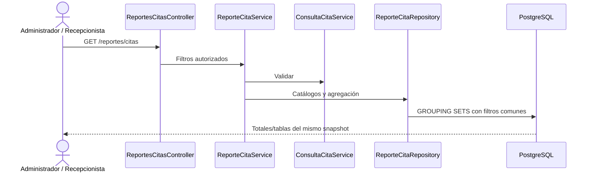

# CU21 — Generar reportes de citas médicas

Rama `feat/ciclo2-cu21-reportes-citas`, desde CU20 `866839ef96122a32426c0298fe8dc89fdc954d0c`.
Consulta administrativa local; no requiere migración ni modifica Render.

## Actores, ruta y flujo

Administrador y recepcionista tienen acceso a los mismos agregados, sin datos
individuales de pacientes. Médico y Paciente reciben 403, incluso manipulando
URL; sin sesión se redirige al login. Controlador y servicio comprueban roles.
Una futura consulta médica propia necesitaría una política específica y resolver
`medicos.usuario_id` desde sesión, con pruebas de aislamiento. No se implementa.
Se conserva el límite actual del portal Paciente y su futura integración CU25.

`GET /reportes/citas`, integrado al menú y panel administrativo. Otros métodos:
405 y `Allow: GET` para autorizados. Autenticación/roles preceden al método.
Flujo: sesión/rol → validar → catálogos mínimos → comprobar IDs → límites UTC →
agregación → tarjetas/tablas. Filtros inválidos: 422 sin cifras parciales.
Se reutiliza el 500 seguro existente; no se expone SQL ni errores internos.
Solo consulta; logout y los demás casos conservan CSRF y sus reglas actuales.

## Filtros y zona horaria

Filtros comunes a todos los reportes: `desde`, `hasta`, `medico_id`,
`especialidad_id`, `estado`. Fechas ausentes/vacías: primer y último día del mes
actual en `America/La_Paz`. Si falta solo una, se completa ese extremo del mes;
un rango resultante invertido se rechaza. Se reutiliza la validación CU14: fechas
reales AAAA-MM-DD, año distinto de cero, orden, tipos, longitud, controles,
IDs positivos y seis estados válidos. IDs numéricos inexistentes: 422.

El período corresponde al **inicio programado vigente** de la cita, nunca a su
creación ni a eventos de cancelación u otras transiciones. Se convierten a UTC
medianoche inicial y medianoche del día posterior al final: `[desde,hasta+1 día)`.
La agrupación diaria usa `(fecha_hora_inicio AT TIME ZONE 'America/La_Paz')::date`.
Los cruces de mes/año y medianoche UTC conservan el día local correcto.
Catálogos incluyen inactivos para consultar su historia; no se exige asociación
médico/especialidad vigente hoy para contabilizar una cita histórica.

## Indicadores y fórmulas

- Total: `COUNT(*)` de citas que cumplen todos los filtros.
- Cada estado: `COUNT(*) FILTER (WHERE estado = estado_elegido)`.
- Total = programada + confirmada + presente + atendida + inasistencia + cancelada.
- Pendientes de llegada: programada y confirmada, diferenciadas.
- Presente: llegada registrada, atención aún sin finalizar.
- Atendida, inasistencia y cancelada: cifras del estado actual.

Los seis estados son mutuamente excluyentes. Presente cuenta citas, no pacientes
distintos. Reprogramar conserva el ID: se cuenta una vez en el horario vigente.
Los eventos no son citas nuevas; no son conteos históricos de transiciones.
Al filtrar un estado, los otros quedan en cero. Puede haber citas futuras:
no se presentan porcentajes, tasas clínicas o estadísticas definitivas de asistencia.

## Tablas y ausencias

1. Estados: seis filas, incluso ceros, y total general.
2. Médicos: ID/nombres/apellidos, total y seis estados; orden por apellidos/nombre/ID.
3. Especialidades: ID/nombre de `citas.especialidad_id`, total y seis estados.
4. Días: fecha local ascendente, total y seis estados.

NULL históricos forman el grupo «Sin registrar», sin inferir especialidad desde
la tabla puente. Un filtro específico excluye NULL. Solo se muestran grupos con
citas; un médico sin citas sigue seleccionable y produce ceros/mensajes vacíos.
Los días omitidos tienen cero citas: no se expanden series ni se inventan filas.
Las sumas de total y de cada estado de cada tabla coinciden con las tarjetas.
Se agrupa por ID además del nombre; nombres iguales no fusionan profesionales.

## Consultas y rendimiento

Tres SELECT preparados: dos catálogos y una agregación `GROUP BY GROUPING SETS`
(general, estado, médico, especialidad, día). Los seis conteos usan `FILTER`.
Todos los indicadores usan el mismo snapshot de sentencia, incluso si otro usuario
modifica una cita simultáneamente. Sin N+1 ni carga de citas individuales en PHP.
PHP solo convierte números y organiza grupos agregados.

JOIN a medicos por PK y LEFT JOIN a especialidades por PK: no multiplican filas.
No se unen `pacientes`, `citas_historial` o `medicos_especialidades`, ni se leen
contactos, documentos, motivos, cuentas o credenciales. WHERE compara límites
con la columna original sin DATE; la zona se aplica solo en la agrupación diaria.
Los índices actuales, incluido `(medico_id,fecha_hora_inicio)`, están disponibles
para el planificador. Un rango global amplio puede recorrer muchas citas; no
se promete uso de índice ni tiempo constante. No se necesita migración 009.

`ReporteCitaService::consultar` devuelve filtros/opciones/agregados independientes
de HTML. CU22 podrá reutilizar datos, cálculos y permisos: no se implementan
exportaciones ni botones o dependencias de ese caso. CSS local responsivo,
tarjetas y tablas; sin librerías de gráficos.

## Reglas e integración

RN-R01–04: sesión y roles; médico/paciente denegados. 05–08: mismos filtros,
validación, zona local y rango exclusivo. 09–12: cita única/estado actual,
suma exacta, sin contar eventos y especialidad propia/NULL explícito.
13–16: PDO parametrizado/agregado, mínimos datos, XSS y errores seguros.
17–20: GET/SELECT, coherencia CU14/CU19/CU20, esquema/servicios intactos, sin CU22.

Para comparar CU19 se selecciona estado «todas», pues oculta canceladas por defecto.
CU20 limita por paciente: para comparar un médico se suman los pacientes del
mismo conjunto. CU14 admite los mismos límites/filtros. No se comparan universos
distintos. Las pruebas conservan las reglas CU11–CU20 y los nueve objetos originales.

Comandos, resultados e inventario: [PRUEBAS_CU21.md](PRUEBAS_CU21.md).
